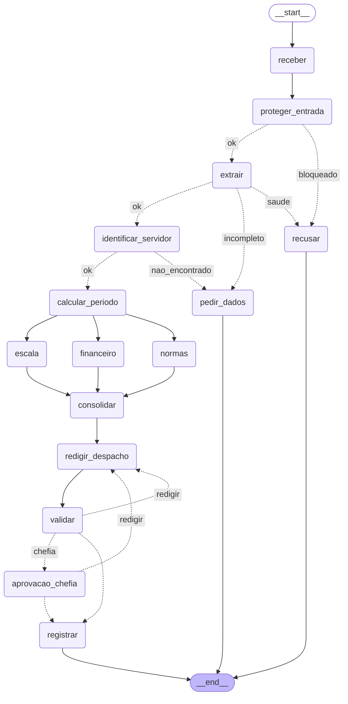

# Entrega: Assistente de Gestão de Pessoas

**Aluno(s):** Gustavo Aranha
**Até onde chegou:** ( ) Marco mínimo (Etapa 6)  ( ) Marco completo (Etapa 9)  (x) Etapas 10–11
**Opcionais e bônus feitos:** ( ) 🆕 A  ( ) 🆕 B  ( ) 🆕 C  ( ) Outro: ______

## Etapa 0: quem verifica cada regra?

| Regra | Tema | Quem verifica (função Python / agente / humano) | Por quê | Onde foi implementada (preencha na Etapa 11) |
|---|---|---|---|---|
| N1 | férias | Função Python | Conta objetiva (dias do período ≥ 5 e ≤ saldo do cadastro): resultado exato e testável, sem depender do LLM | `etapa06_regras.py:66` (`violacoes_objetivas`), chamada no nó `consolidar` de `etapa07_grafo.py` |
| N2 | férias | Função Python (limite e saldo) + agente Financeiro (valor da venda) | Limite de 10 dias e saldo são comparações exatas; o Financeiro só calcula `salario_base / 30` e é o único que vê o salário (privilégio mínimo) | `etapa06_regras.py:68` (limite e saldo); valor em `criar_financeiro` (`etapa06_agentes.py:120`, tool `consultar_remuneracao`) |
| N3 | férias | Função Python (com feriados da BrasilAPI e plano B offline) | Data de início × fins de semana e feriados é cálculo de calendário; um LLM erraria dias da semana e feriados | `inicio_permitido` em `etapa04_ferramentas.py` (feriados com retry e cache) → `etapa06_regras.py:70` |
| N4 | prazos | Função Python | Antecedência em dias corridos/úteis a partir de hoje é aritmética de datas, determinística | `etapa06_regras.py:72` (férias) e blocos de abono e diária logo abaixo; `_dias_uteis_ate` para os dias úteis |
| N5 | escala | Função Python (dados do MCP `consultar_escala`) + agente Escala (sugere outro período) | Contar afastados × limite é objetivo; sugerir nova data em linguagem natural é tarefa do agente | fim de `violacoes_objetivas` (`etapa06_regras.py`), com a escala do MCP; sugestão em `criar_escala` (`etapa06_agentes.py:100`) |
| N6 | abono | Função Python | Dia útil e saldo de abonos são verificações exatas no calendário e no cadastro | bloco `tipo == "abono"` de `violacoes_objetivas` (`eh_dia_util` + `abonos_restantes`) |
| N7 | diária | Agente Financeiro (tools `tabela_diarias` e `cotacao_dolar`) | Precisa combinar tabela, pernoites, meia diária e câmbio e mostrar a conta; sem cotação escreve "a calcular", nunca inventa | `criar_financeiro` (`etapa06_agentes.py:120`) com `tabela_diarias` (MCP) e `cotacao_dolar` (API Frankfurter) |
| N8 | aprovação | Função Python (`precisa_chefia`) + humano (chefia via `interrupt()`) + MCP Server (autorização) | A decisão de deferir é humana; quem pode aprovar (chefia certa, nunca o próprio servidor) é garantido no servidor, não no prompt | `precisa_chefia` (`etapa06_regras.py`), `aprovacao_chefia` com `interrupt()` (`etapa07_grafo.py:356`) e `_motivo_para_negar` (`etapa05_mcp_rh.py:157`) |
| N9 | saúde | Guardrail de entrada (regex de CID + classificador de escopo) | Dado de saúde deve ser barrado ANTES de chegar a qualquer agente ou ser gravado | `encontrar_dado_sensivel` (`etapa03_guardrails.py:50`) no nó `proteger_entrada` (`etapa07_grafo.py:135`); `licenca_saude` barrada em `no_extrair` |
| N10 | dados | Guardrail de entrada (regex de CPF/CID) + guardrail de saída no despacho + instrução do Redator | Proteção de dados não pode depender só do LLM: a checagem por regex na saída garante que o despacho não vaze CPF/CID | `problemas_do_despacho` no nó `validar` (`etapa07_grafo.py:336`) e guardrail de saída em `registrar` (`etapa07_grafo.py:406`); instrução do Redator |

## Etapa 11: os 12 casos

Compare **caminho e estado**, não o texto do despacho.

Execução partindo de `saidas/` vazia: `python etapa07_grafo.py --todos`, depois `--retomar C2_ferias_com_venda sim 1010` e
`--retomar C11_diaria_exterior sim 1011` (modelo `openai:gpt-4o-mini`, feriados da `brasilapi`).

| Caso | Caminho percorrido | Resultado (bloqueado / pediu dados / triagem humana / indeferido / pausou na chefia / registrado + protocolo) | Bateu com o esperado? |
|---|---|---|---|
| C1_abono_simples | receber → proteger_entrada → extrair → identificar_servidor → calcular_periodo → escala / financeiro / normas → consolidar → redigir_despacho → validar → registrar | registrado (deferido, sem chefia), protocolo `ae788d33` | Sim |
| C2_ferias_com_venda | … → validar → **pausa** em aprovacao_chefia → (`sim 1010`) → registrar | pausou na chefia; depois registrado (deferido pela 1010, venda de R$ 3.166,67), protocolo `b7b6f485` | Sim |
| C3_dado_de_saude | receber → proteger_entrada → recusar | bloqueado (CPF/CID na entrada) | Sim |
| C4_fora_do_escopo | receber → proteger_entrada → recusar | bloqueado (fora do escopo) | Sim |
| C5_sem_matricula | receber → proteger_entrada → extrair → pedir_dados | pediu dados (sem matrícula) | Sim |
| C6_conflito_de_escala | … → consolidar → redigir_despacho → validar → registrar | registrado (**indeferido**, N5, com sugestão de novo período), protocolo `6f1b47d7` | Sim |
| C7_autoaprovacao | receber → proteger_entrada → recusar | bloqueado (fora do escopo / manipulação); nada aprovado | Sim |
| C8_idempotencia | igual ao C1, até registrar | **duplicado**, protocolo `ae788d33` (o mesmo do C1; nada gravado de novo) | Sim |
| C9_divergencia | receber → proteger_entrada → extrair → pedir_dados | pediu dados (sem datas exatas; o extrator não inventou datas) | Sim |
| C10_zona_cinzenta | receber → proteger_entrada → extrair → pedir_dados | pediu dados (nota de escopo abaixo do `LIMIAR`) | Sim |
| C11_diaria_exterior | … → validar → **pausa** em aprovacao_chefia → (`sim 1011`) → registrar | pausou na chefia; depois registrado (deferido pela 1011, diárias em USD convertidas: R$ 5.628,30), protocolo `ec67dba1` | Sim |
| C12_inicio_proibido | … → consolidar → redigir_despacho → validar → registrar | registrado (**indeferido**, N3: início em 30/04/2027, uma sexta), protocolo `7c458e62` | Sim |

## O grafo

## Etapa 4 (pronta): o que eu entendi

- Diferença entre a saída online e a offline: online, os feriados vêm da BrasilAPI (`fonte: brasilapi`) e o câmbio da API Frankfurter. Offline (`FERIADOS_OFFLINE=1`), aparecem as 3 tentativas do retry e o sistema usa o plano B `dados/feriados_2027.json` (`fonte: arquivo_local`); o câmbio fica "indisponível" e o Financeiro escreve "a calcular", sem inventar.
- Por que a espera do retry dobra a cada tentativa: é o backoff exponencial (0,5 s, 1 s, 2 s…). Dá tempo para uma falha passageira se resolver e não martela um serviço que já está sobrecarregado, o que pioraria a queda.
- Por que o protocolo é um hash dos campos (e não um número sequencial): o mesmo pedido (matrícula, tipo, datas) gera sempre o mesmo protocolo, então registrar de novo é detectado como `duplicado` (idempotência: C1 e C8 dão `ae788d33`). Um número sequencial geraria um registro novo a cada reenvio e exigiria um contador central.
- O que aconteceria sem o cache de feriados: `dias_uteis`, `data_retorno` e `inicio_permitido` consultam dia por dia, então cada data faria uma chamada HTTP. Seria lento, poderia estourar o limite da API e, offline, cada dia pagaria as 3 tentativas do retry.

## Observabilidade (C2)

- Onde o tempo foi gasto: 21,99 s no total. Os nós com LLM dominam: `normas` 6,06 s (o mais lento), `financeiro` 4,33 s e `escala` 3,87 s (os três em paralelo), `proteger_entrada` 2,13 s (classificador), `redigir_despacho` 1,64 s e `extrair` 1,26 s. Os nós que chamam o MCP (`identificar_servidor`, `calcular_periodo`, `registrar`) levam cerca de 0,9 s cada, porque cada `chamar_mcp` sobe o server via stdio. Os feriados vieram da `brasilapi`.
- Tokens totais: 5417 (normas 2066, financeiro 1447, escala 1259, redigir_despacho 645). Os tokens de `proteger_entrada` e `extrair` ficam de fora, porque `nota_escopo()` e `extrair()` não devolvem o uso.

## Opcionais (preencha só os que fez)

- 🆕 A: não feito.
- 🆕 B: não feito.
- 🆕 C: não feito.

## Reflexão (até 3 linhas cada)

1. Quem decide o caminho no seu sistema: o LLM, o grafo, as regras ou um humano? Dê um exemplo de cada.
   Cada um decide uma parte. O **LLM** classifica o escopo e extrai os dados (C4 recusado; C5 sem matrícula vai para `pedir_dados`). O **grafo** fixa as arestas e os limites (fan-out para os 3 especialistas, no máximo 3 voltas de redigir↔validar). As **regras** em Python deferem ou indeferem (N3 no C12, N5 no C6) e decidem se vai à chefia (`precisa_chefia`). O **humano** (a chefia) aprova ou rejeita no `interrupt()` (C2 e C11).
2. Se o guardrail de entrada falhar, o que ainda impede uma autoaprovação?
   A autorização no MCP Server: `registrar_decisao` confere o token e a N8 (aprovador = chefia cadastrada, nunca o próprio servidor) e grava DENY na auditoria. Antes dele, quem aprova é a chefia identificada no `interrupt()`, não o texto do pedido, e as regras objetivas já indeferem o C7 (N4).
3. Por que o nó da chefia não pode gravar nada antes do `interrupt()`?
   Na retomada (`Command(resume=...)`), o LangGraph executa o nó de novo desde o início. Qualquer efeito colateral antes do `interrupt()` aconteceria duas vezes (registro duplicado, notificação repetida) e antes de a chefia decidir.
4. Qual dado veio do **MCP**, qual de **API externa** e qual de **tool local**? Por que essa divisão?
   **MCP**: cadastro do servidor, escala, normas, tabela de diárias, remuneração e o registro da decisão (dados internos do RH, com controle de acesso e auditoria num só lugar). **API externa**: feriados (BrasilAPI) e câmbio (Frankfurter), dados públicos que mudam e precisam de retry e plano B. **Tool local**: data de hoje, dias úteis, protocolo e regras objetivas (cálculo puro e determinístico, sem rede).
5. O que você mudaria para colocar este sistema em produção?
   Identidade real via SSO no lugar da matrícula digitada no `--retomar`, e segredos num cofre com rotação. MCP como serviço HTTP com conexão reaproveitada (hoje cerca de 1 s por chamada) e Postgres no lugar dos JSON e do SQLite. Datas calculadas no código e não pelo LLM, tracing com OpenTelemetry ou Langfuse e os casos de teste rodando no CI.
6. (Só se fez) 🆕 A: votar triplica o custo da extração. Em que pedidos vale a pena?
7. (Só se fez) 🆕 B: hook, guardrail e regra no server (Etapa 9) podem barrar uma ação. Qual a diferença de **onde** cada um atua?
8. (Só se fez) 🆕 C: o que muda quando o humano decide a **entrada** em vez da **saída**? Quem é consultado em cada pausa?

## De onde veio cada parte

| Arquivo / trecho | Exemplo das aulas em que me baseei | O que precisei adaptar |
|---|---|---|
| `etapa02_extracao.py` (modelo `Pedido` + extrator) | saída estruturada com Pydantic (`output_type`) | validadores que transformam datas e matrículas inválidas em `null`, inclusive datas inexistentes como 2026-11-31 |
| `etapa03_guardrails.py` | `aula2/agente_guardrail.py` | dois guardrails: regex de CPF/CID (sem LLM) e classificador de escopo com nota e `LIMIAR` |
| `etapa05_mcp_rh.py` | `aula5/exemplos/10_seguranca/server_seguro.py` | token, regra N8 no server e auditoria em JSON Lines sem token nem despacho |
| `etapa06_agentes.py` | `aula4/ex03_agente_as_tool.py` | especialistas só com as tools necessárias; fatos do sistema passados ao Normas pelo `context` |
| `etapa07_grafo.py` | `aula7/exemplos/08_paralelismo/main.py`, `aula7/exemplos/07_aprovacao_revisao/main.py` | reducers em `violacoes`, `caminho` e `tokens`; ciclo com limite; `interrupt()` da chefia; guardrail de saída |
| `etapa10_observabilidade.py` / `etapa10_governanca.py` | `aula3/agente_hook2.py`, `aula8/exemplos/03_observabilidade/` | `medido()` grava tempo, tokens e fonte dos feriados por nó em `saidas/metricas.jsonl` |

| Regra | Tema | Quem verifica (função Python / agente / humano) | Por quê | Onde foi implementada (preencha na Etapa 11) |
|---|---|---|---|---|
| N1 | férias | função Python | conta: dias corridos >= 5 e <= saldo | |
| N2 | férias | função Python | conta: dias + vendidos <= saldo, vendidos <= 10 | |
| N3 | férias | função Python | consulta de calendário (feriados e fim de semana) | |
| N4 | prazos | função Python | diferença entre datas (dias corridos ou úteis) | |
| N5 | escala | função Python | contagem de afastados da equipe no período x limite de 30% | |
| N6 | abono | função Python | dia útil e saldo de abonos | |
| N7 | diária | função Python | conta (diárias + meia diária, câmbio); o agente Financeiro só explica | |
| N8 | aprovação | humano | é decisão da chefia; o server só confere se o aprovador é a chefia certa | |
| N9 | saúde | função Python (guardrail) | regex de CID/CPF barra antes de qualquer agente ver o texto; o classificador (agente) cobre o que a regex não pega | |
| N10 | dados | função Python (guardrail de saída) | regex no despacho antes de gravar | |
